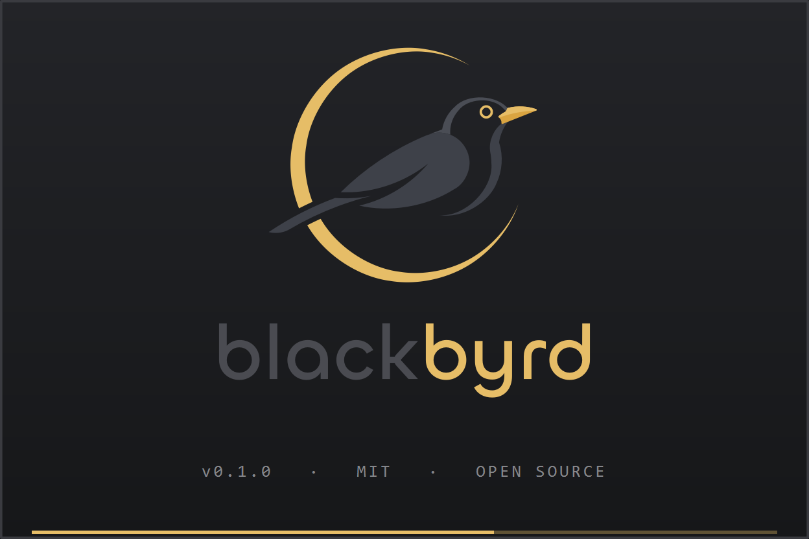
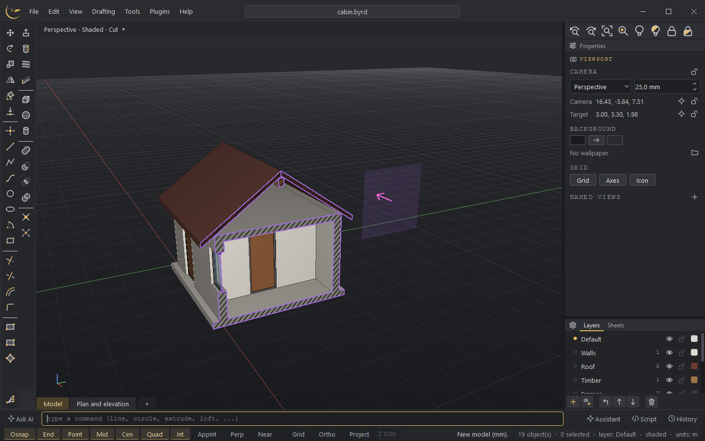
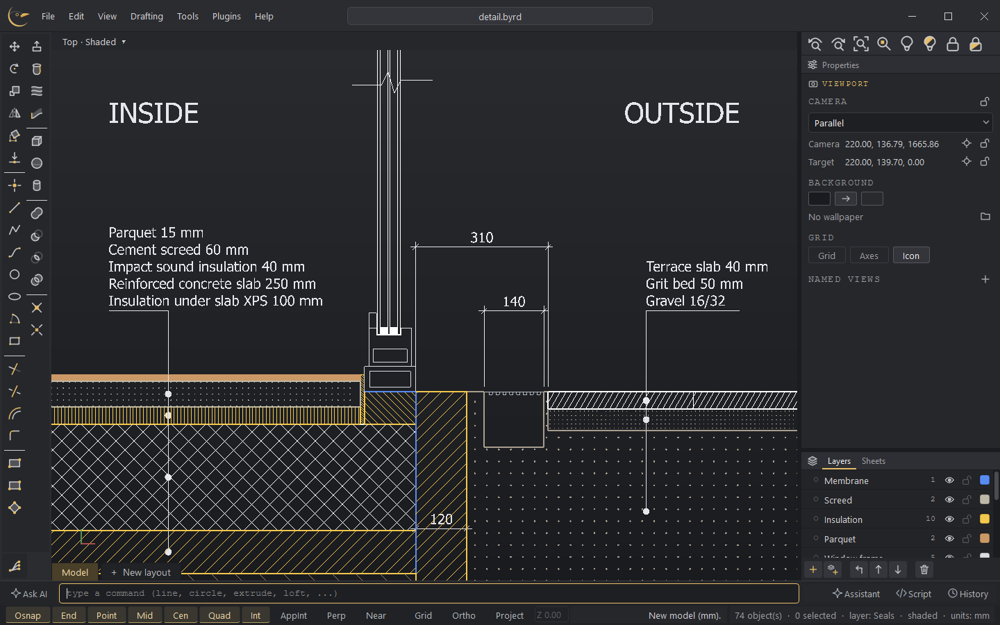
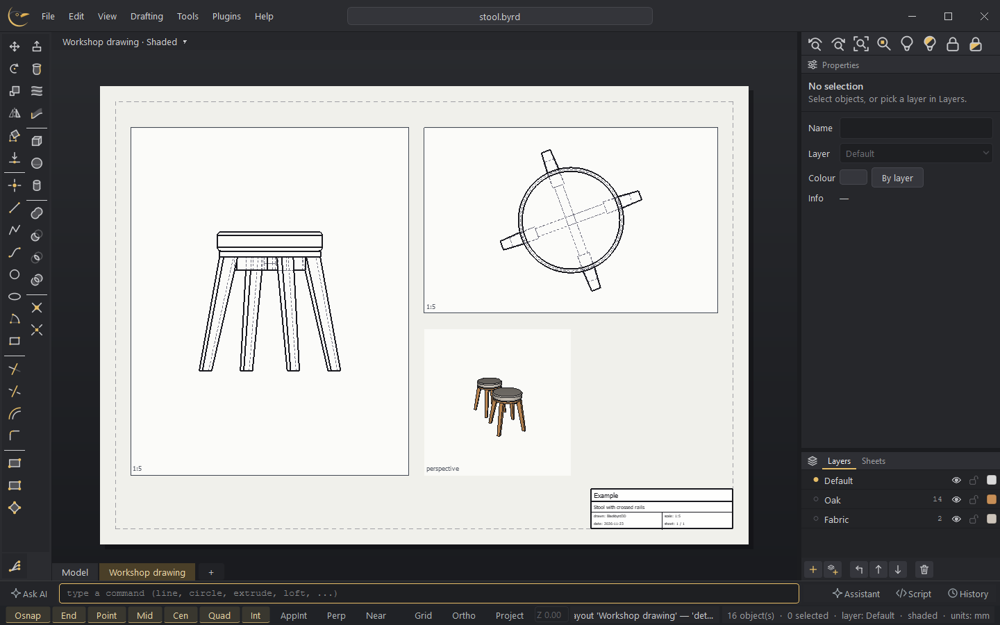
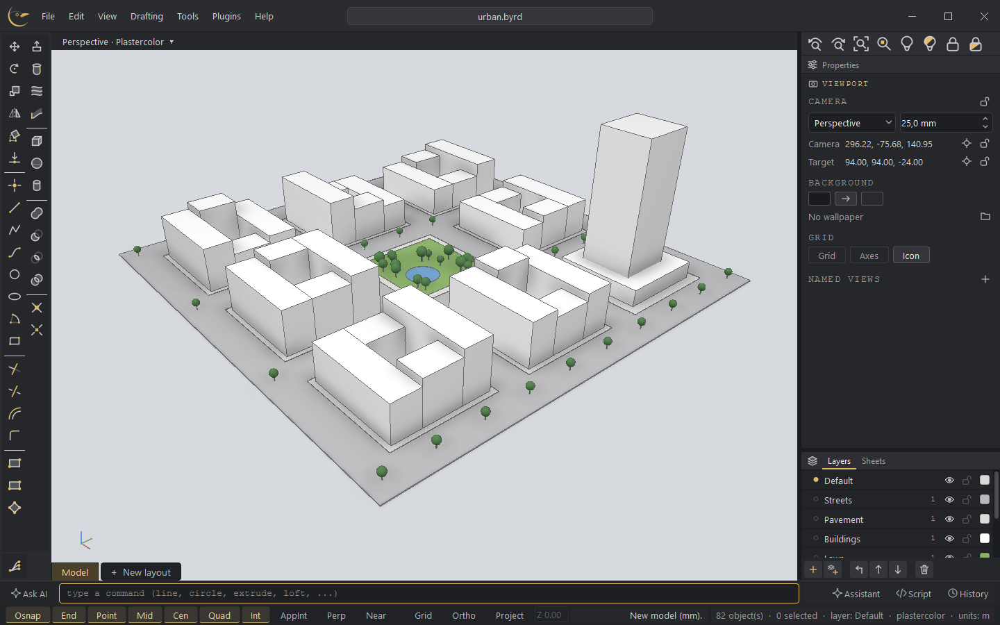
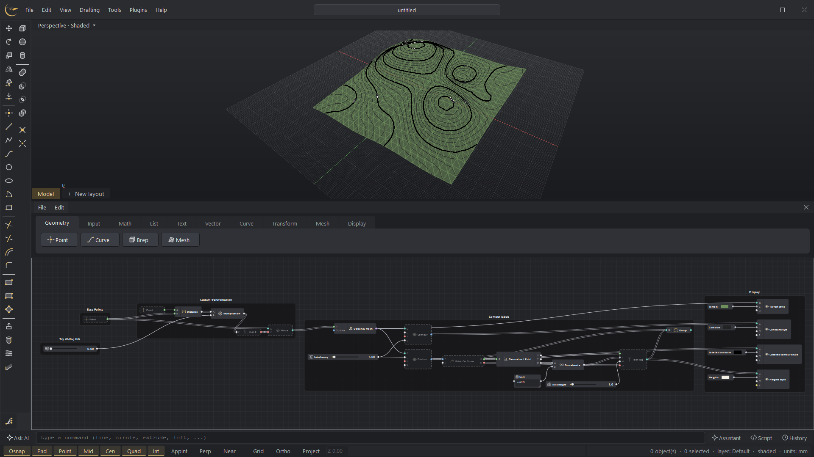

<div align="center">


# Blackbyrd3D

**Open-source NURBS modelling for Rhino users and 3D CAD designers.**<br>
One program for 2D drawing and 3D planning, from first sketch to finished plan.<br>
With the commands and `.3dm` files you know, on its own OpenCASCADE kernel.<br>
Linux, Windows and macOS. Free.

Built on [Serpentine3D](https://github.com/chisomobanzi/Serpentine3D) by Chisomo Banzi.

[**Download**](#download) · [Documentation](docs/index.md) · [Coming from Rhino?](docs/coming-from-rhino.md) · [Roadmap](ROADMAP.md) · [Issues](https://github.com/JonasPedrotti/Blackbyrd3D/issues)



<a href="docs/reference/file-formats.md"></a>
<a href="docs/reference/file-formats.md"></a>
<a href="docs/reference/file-formats.md"></a>
<a href="docs/reference/file-formats.md"></a>
<a href="docs/reference/file-formats.md"></a>
<a href="docs/reference/file-formats.md"></a>
<a href="docs/reference/file-formats.md"></a>
<a href="docs/reference/file-formats.md"></a>
<a href="docs/reference/file-formats.md"></a>

</div>

## What it does

- **Exact geometry.** NURBS curves, surfaces and solids on the OpenCASCADE
  kernel, not meshes. Rhino `.3dm`, STEP, DXF, SVG, OBJ, FBX and STL in and
  out; glTF, USD and 3MF out; E57 point clouds in.
- **A command line that speaks Rhino.** `loft`, `setpt`, `filletedge`,
  `booleanunion` and more than 200 others, with Rhino's aliases, object
  snaps, layers and a gumball that pushes faces and rounds edges by hand.
- **Drawings from the model.** A4 to A0 sheets with live detail views,
  hidden-line views, dimensions, hatching and title blocks, printed to
  vector PDF.
- **An assistant that can see.** Describe a change and it runs the commands,
  looks at the viewport to check its work and fixes its own mistakes, all
  undoable. Use Claude, a ChatGPT account, an OpenAI key, or a local,
  open-weight model.
- **Headless.** Script it in the built-in editor, batch it with
  `byrd3d-batch`, or let any MCP client drive a live session. See the
  [scripting guide](docs/howto/scripting.md) and the
  [assistant and MCP guide](docs/howto/ai-mcp.md).

## How it differs from Serpentine3D

Blackbyrd3D started from Serpentine3D and has changed a fair bit, with
ten thousands lines of code added or rewritten across some 700 files:

- **Interface.** A reworked UI with new icons, new popups and better
  workflows.
- **Commands.** Many new commands, and existing ones fixed.
- **Interoperability.** New file types, and better import of Rhino `.3dm`
  and DXF files.
- **[Wyrm](#wyrm).** A node editor for driving the model from a graph.

## Examples

Four examples open from the welcome screen, so there is something to try
before you draw a line.

|                                                                                                                                                                                    |                                                                                                                         |
| ---------------------------------------------------------------------------------------------------------------------------------------------------------------------------------- | ----------------------------------------------------------------------------------------------------------------------- |
|  |  |
| **3D modelling** with surfaces, solids, boolean operations and clipping planes.                                                                                                    | **2D drafting** with lineweights, material hatches, dimensions and text.                                                |
|                                                                                    |                    |
| **Workshop sheets** with live views of the solid model at 1:5.                                                                                                                     | **Plaster colour display** with ambient occlusion and block instances.                                                  |

## Wyrm

Wyrm is a visual node editor for parametric modelling. Wire components into
a graph, pick objects from the model as inputs, drag a number slider and
watch the geometry follow. Data flows as trees of branches, with graft,
flatten and reverse on any port, so one graph can handle a single curve or
hundreds of them.



The example graph on Wyrm's start page turns a set of points into a terrain,
cuts it into contours and tags the main ones with their height. Custom
Preview components give the terrain, the contours and the labels a colour
of their own.

## Download

| Platform    | Download                                                                                                                           | Size        | Notes                                                                                                                                                               |
| ----------- | ---------------------------------------------------------------------------------------------------------------------------------- | ----------- | ------------------------------------------------------------------------------------------------------------------------------------------------------------------- |
| **Linux**   | [Blackbyrd3D-x86_64.AppImage](https://github.com/JonasPedrotti/Blackbyrd3D/releases/latest/download/Blackbyrd3D-x86_64.AppImage)   | 269&nbsp;MB | Make it executable and run it. Nothing to install.                                                                                                                  |
| **Linux ARM** | [Blackbyrd3D-aarch64.AppImage](https://github.com/JonasPedrotti/Blackbyrd3D/releases/latest/download/Blackbyrd3D-aarch64.AppImage) | -           | 64-bit ARM with glibc 2.39 or newer, such as Ubuntu 24.04 or Fedora 40. E57 import is not available there yet.                                                      |
| **Windows** | [Blackbyrd3D-Setup-x86_64.exe](https://github.com/JonasPedrotti/Blackbyrd3D/releases/latest/download/Blackbyrd3D-Setup-x86_64.exe) | 119&nbsp;MB | Unsigned for now: choose **More info**, then **Run anyway**.                                                                                                        |
| **macOS**   | [Blackbyrd3D-arm64.dmg](https://github.com/JonasPedrotti/Blackbyrd3D/releases/latest/download/Blackbyrd3D-arm64.dmg)   | 268&nbsp;MB | Apple Silicon, macOS 14 or newer. Not notarized yet: on first launch macOS blocks it, then open **System Settings > Privacy & Security** and click **Open Anyway**. |

On Linux, make the AppImage executable and start it:

```bash
chmod +x Blackbyrd3D-x86_64.AppImage
./Blackbyrd3D-x86_64.AppImage
```

On ARM, use `Blackbyrd3D-aarch64.AppImage` the same way.

On a Wayland desktop it runs through XWayland, so panels can be torn off and
docked again. Set `BYRD3D_WAYLAND=1` to run it on Wayland directly. Known
issues, seen on COSMIC: once Wyrm has been docked and torn off again, its
floating window can no longer be dragged by its title bar, and dialogs open
where the desktop places them rather than centred on the window.

Each build carries the OpenCASCADE kernel and its own Python, and needs a GPU
with OpenGL 3.3. Headless use works anywhere. [Release notes](https://github.com/JonasPedrotti/Blackbyrd3D/releases/latest) · [Privacy](docs/privacy.md)

## Give it a try

Download it, open one of your own files and see how far you get. Then let
me know: what works, what breaks, what you miss. Every
[issue](https://github.com/JonasPedrotti/Blackbyrd3D/issues) gets read, and real world feedback shapes what
comes next.

Fair warning: Blackbyrd3D is young, and you will run into bugs. With your
help, they get fixed. Thanks in advance!

## Documentation

| Start here                                         | How-to                                    | Reference                                        |
| -------------------------------------------------- | ----------------------------------------- | ------------------------------------------------ |
| [Install](docs/getstarted/install.md)              | [Drawings](docs/howto/drawings.md)        | [Commands](docs/reference/commands.md)           |
| [Your first model](docs/getstarted/first-model.md) | [Scripting](docs/howto/scripting.md)      | [File formats](docs/reference/file-formats.md)   |
| [Coming from Rhino](docs/coming-from-rhino.md)     | [Assistant and MCP](docs/howto/ai-mcp.md) | [Keyboard](docs/reference/keyboard.md)           |
|                                                    | [3D printing](docs/howto/3d-printing.md)  | [How it works](docs/explanation/how-it-works.md) |

## Roadmap

| Milestone                 | Progress                         |
| ------------------------- | -------------------------------- |
| **1. Solid basics**       | `██████████████░░░░░░` 70&nbsp;% |
| **2. Expanding the base** | `██████░░░░░░░░░░░░░░` 30&nbsp;% |
| **3. Wyrm**               | `██████░░░░░░░░░░░░░░` 30&nbsp;% |
| **4. Laser**              | `██░░░░░░░░░░░░░░░░░░` 10&nbsp;% |
| **5. CAM**                | `░░░░░░░░░░░░░░░░░░░░` 0&nbsp;%  |

The numbers are a very rough estimate. They can and will change.
What each step means: [ROADMAP.md](ROADMAP.md).

## Is this AI slop?

Fair question, so a straight answer: Blackbyrd3D is indeed written with a lot
of help from AI. Pretending otherwise would be dishonest.

But there is vibe coding and there is using AI as a tool. One is prompting until
something seems legit and shipping whatever comes out.
The other is deciding what gets built and how it should behave, then going back and forth between
testing by hand and working with the AI until it does exactly what it
should. Blackbyrd3D is made the second way.
And not everything comes from a prompt: the branding, for example, is
designed by hand.

Every change is tested by hand in the running app, on top of an automated
test suite. Mistakes can still slip through, as in any software. If you find
one, please [open an issue](https://github.com/JonasPedrotti/Blackbyrd3D/issues).

## Build from source

```bash
git clone https://github.com/JonasPedrotti/Blackbyrd3D && cd Blackbyrd3D
python3 -m venv .venv && .venv/bin/pip install -e ".[dev]"
.venv/bin/byrd3d        # the app
.venv/bin/pytest -n 8   # the tests
```

How to run the tests and how CI runs them: [CONTRIBUTING.md](CONTRIBUTING.md#running-the-tests).

Python 3.10 or later. The kernel installs as pip wheels (`cadquery-ocp`), with
no conda and no system packages, on Linux, Windows and macOS alike.

## Support

Blackbyrd3D is free and always will be: no subscription, no licence server, no
"upgrade to Pro".

Bug reports, sample files and documentation fixes help the most
see [CONTRIBUTING.md](CONTRIBUTING.md), and
[Not here yet](docs/coming-from-rhino.md#not-here-yet) for what is missing.

MIT licensed.
